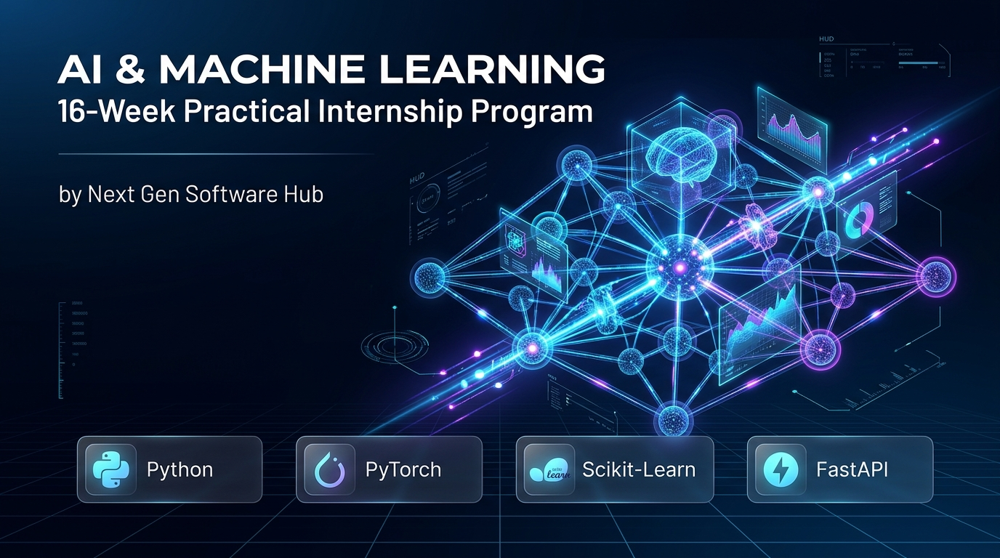

# AI & Machine Learning 16-Week Practical Internship Program
### Next Gen Software Hub Pvt. Ltd.



Welcome to the **16-Week Practical AI & Machine Learning Internship** at **Next Gen Software Hub Pvt. Ltd.** This program is structured to provide students with hands-on, practical engineering experience across Python, Data Analysis, Machine Learning, Deep Learning, Computer Vision, NLP, Recommendation Systems, and AI Application Deployment.

---

## 🎯 Internship Objective & Learning Outcome
The objective of this 16-week internship is to master the complete real-world AI/ML workflow:
```
Python ➔ Data Analysis ➔ Data Preprocessing ➔ EDA ➔ Machine Learning ➔
Model Optimization ➔ Deep Learning ➔ Computer Vision ➔ NLP ➔
Recommendation Systems ➔ AI Application ➔ Deployment
```
Students complete a portfolio-ready AI/ML capstone project demonstrating their practical skills in Artificial Intelligence and Machine Learning.

---

## 🗓️ 16-Week Program Architecture (5 Phases)

```
┌───────────────────────────────────────────────────────────────────────────────────────────────────┐
│                           16-WEEK PRACTICAL TASK ROADMAP MATRIX                                   │
├───────────────────────────────┬─────────────────────────────────┬─────────────────────────────────┤
│ PHASE 1: Python & Data (W1-4) │ PHASE 2: Machine Learning (W5-8)│ PHASE 3: Adv. ML (W9-10)        │
│ • W01: Python Programming     │ • W05: ML Fundamentals          │ • W09: Feature Eng. & Tuning    │
│ • W02: NumPy, Pandas, Viz     │ • W06: Classification Algorithms│ • W10: Ensemble Learning        │
│ • W03: Data Cleaning & Prep   │ • W07: Regression Algorithms    │                                 │
│ • W04: Exploratory Data Anal. │ • W08: Unsupervised & Clustering│                                 │
├───────────────────────────────┴─────────────────────────────────┼─────────────────────────────────┤
│ PHASE 4: Deep Learning & Specialized AI (W11-14)                │ PHASE 5: Deployment (W15-16)    │
│ • W11: Neural Networks (Intro to Deep Learning)                 │ • W15: AI App Development       │
│ • W12: Computer Vision (Image Classification with CNN)          │ • W16: Final AI & ML Capstone   │
│ • W13: Natural Language Processing (Text Class. & Sentiment)    │   Project (14-Step Workflow)    │
│ • W14: Recommendation Systems (Content-Based & Similarity)      │                                 │
└─────────────────────────────────────────────────────────────────┴─────────────────────────────────┘
```

---

## 📁 Repository Directory Structure

```
d:/Next Gen Software Hub Pvt. Ltd/
├── README.md                                          # Master Program Overview & Guidelines
├── CURRICULUM.md                                      # Official 16-Week Syllabus & Deliverables
├── requirements.txt                                   # Python Dependencies (16/16 verified)
├── environment.yml                                    # Conda / Mamba Environment Specification
├── setup_internship_env.py                            # Diagnostic Environment Checker Script
│
├── phase-1-python-data-fundamentals/
│   ├── week-01-python-programming/                    # Python Fundamentals & OOP
│   │   └── student_management_system/                 # Full Reference CLI Solution + 9 Unit Tests
│   ├── week-02-numpy-pandas-visualization/            # Data Analysis & 6 Visualizations
│   │   ├── datasets/ecommerce_sales_data.csv
│   │   └── starter_notebook.ipynb
│   ├── week-03-data-cleaning-preprocessing/           # Missing Values, Outliers & Encoding
│   │   ├── datasets/customer_churn_raw.csv
│   │   └── starter_notebook.ipynb
│   └── week-04-exploratory-data-analysis/             # 15 Analytical Questions & 10+ Plots
│       ├── datasets/employee_attrition_data.csv
│       └── starter_notebook.ipynb
│
├── phase-2-machine-learning/
│   ├── week-05-ml-fundamentals/                       # Supervised/Unsupervised Basics & Regression
│   │   ├── datasets/experience_salary_data.csv
│   │   └── starter_notebook.ipynb
│   ├── week-06-classification-algorithms/             # Multi-Model Benchmark (5 Classifiers)
│   │   ├── datasets/loan_default_data.csv
│   │   └── starter_notebook.ipynb
│   ├── week-07-regression-algorithms/                 # Linear, Ridge, Tree, Random Forest & Residuals
│   │   ├── datasets/housing_prices_data.csv
│   │   └── starter_notebook.ipynb
│   └── week-08-unsupervised-clustering/               # K-Means, Elbow Method, Silhouette & PCA
│       ├── datasets/mall_customers_segmentation.csv
│       └── starter_notebook.ipynb
│
├── phase-3-advanced-machine-learning/
│   ├── week-09-feature-engineering-optimization/      # Feature Selection, K-Fold & GridSearchCV
│   │   ├── datasets/telecom_churn_features.csv
│   │   └── starter_notebook.ipynb
│   └── week-10-ensemble-learning/                     # Bagging, AdaBoost, Gradient Boosting, Soft Voting
│       ├── datasets/credit_scoring_ensemble.csv
│       └── starter_notebook.ipynb
│
├── phase-4-deep-learning/
│   ├── week-11-neural-networks/                       # Intro to DL, PyTorch ANN, Backprop & Loss Curves
│   │   ├── datasets/sensor_fault_detection.csv
│   │   └── starter_notebook.ipynb
│   ├── week-12-computer-vision/                       # Convolutions, Pooling, CNN, Fashion-MNIST
│   │   └── starter_notebook.ipynb
│   ├── week-13-natural-language-processing/           # Preprocessing, TF-IDF, Spam & Sentiment
│   │   ├── datasets/sms_spam_text_data.csv
│   │   └── starter_notebook.ipynb
│   └── week-14-recommendation-systems/                # Content-Based Filtering & Cosine Similarity
│       ├── datasets/movies_recommendation_data.csv
│       ├── starter_notebook.ipynb
│       └── recommender_engine.py
│
├── phase-5-ai-application-deployment/
│   ├── week-15-ai-application-development/            # Interactive Streamlit UI & FastAPI Service
│   │   └── sample_app/
│   │       ├── api.py                                 # FastAPI REST backend with Pydantic validation
│   │       ├── streamlit_app.py                       # Single + Batch CSV predictions UI
│   │       └── artifacts/loan_model.joblib            # Trained production inference model
│   └── week-16-final-capstone-project/                # End-to-End Capstone Project
│       ├── README.md                                  # 14-Step Workflow & Submission Checklist
│       └── capstone_template/
│           ├── proposal_template.md                   # Capstone Project Proposal
│           └── final_report_template.md               # 19-Section Technical Project Report
│
└── templates/
    ├── weekly_submission_template.md                  # Weekly Student Report Format
    └── project_rubric.md                              # 100-Point Grading Criteria
```

---

## 🛠️ Recommended Technology Stack
- **Programming:** Python 3.10+
- **Data Analysis:** NumPy, Pandas, Matplotlib, Seaborn
- **Machine Learning:** Scikit-Learn, Joblib
- **Deep Learning:** PyTorch or TensorFlow / Keras
- **NLP:** NLTK, spaCy, Hugging Face Transformers
- **Development Runtimes:** Jupyter Notebook, Google Colab, VS Code
- **Deployment:** Streamlit, Flask, Gradio, FastAPI, Uvicorn
- **Version Control:** Git & GitHub

---

## ⚡ Quick Start & Environment Verification

### 1. Diagnostic Environment Checker
Run the built-in checker to verify your Python setup:
```bash
python setup_internship_env.py
```
*(All 16 required libraries are pre-verified and active)*

### 2. Run Week 1 Student Management System CLI
```bash
python phase-1-python-data-fundamentals/week-01-python-programming/student_management_system/main.py
```

### 3. Run Week 1 Automated Unit Tests
```bash
pytest phase-1-python-data-fundamentals/week-01-python-programming/student_management_system/tests/
```

### 4. Run Week 14 Recommendation Engine
```bash
python phase-4-deep-learning/week-14-recommendation-systems/recommender_engine.py
```

### 5. Run Week 15 AI Web Application
```bash
cd "phase-5-ai-application-deployment/week-15-ai-application-development/sample_app"

# Terminal 1 (FastAPI backend):
uvicorn api:app --reload --port 8000

# Terminal 2 (Streamlit frontend):
streamlit run streamlit_app.py
```

---

## 📜 General Academic & Engineering Guidelines
- **Original Work Only:** Direct copy-pasting from internet sources will lead to disqualification.
- **Citation:** Explicitly cite the sources of datasets and external resources.
- **Code Organization:** Keep notebooks and code cleanly structured, documented, and PEP 8 compliant.
- **Version Control:** Maintain git repositories on GitHub with frequent, descriptive commits.
- **Model Validation:** Test models for generalization before final submission.
- **Defense Preparation:** Be prepared to explain your code, architectural decisions, metrics, and business insights.

---
*Next Gen Software Hub Pvt. Ltd. — Mentorship & Engineering Team*
